<div align="center">

<picture>
  <source media="(prefers-color-scheme: dark)" srcset="web/public/brand/logo-horizontal-dark.svg">
  
</picture>

**Drag. Review. Branch.**<br>
A visual portal that turns an approved module catalog into Terraform module calls, and stops at a branch.


</div>

<br>

## What it is

People compose infrastructure from an **approved module catalog**. A reviewer (the project owner or a co-owner) approves.
TerraFlow then writes Terraform **module calls** in the team's own style and opens a **branch** on the project's GitHub repository.

> **The job ends at the branch.** The pull request, pipeline, plan and apply stay with the team in the git provider.
> TerraFlow never calls Azure and holds no Azure credential.

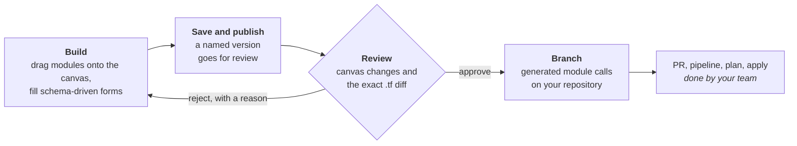

## Why it is built this way

| | |
|---|---|
| **Schema-driven** | Every form is drawn from a module's schema (`variables.tf` as JSON Schema). Adding a module needs no UI code. |
| **Module calls, not raw resources** | The generator writes `module "x" { source = ... }`. A raw provider resource exists only when someone adds it on purpose, from a template an admin prepared. |
| **Reads the repo, not Azure** | The existing inventory is parsed from your `.tf` files. A value that cannot be evaluated is shown as `unknown`, never as `0` or healthy. |
| **Append-only generation** | New code is added to a file; lines already there stay byte for byte, comments included. Golden-file and round-trip tests keep that true. |
| **Least privilege** | A GitHub App that can create a branch on one repository, with one-hour tokens that are never stored. No pasted personal tokens, no Azure access. |
| **Review first** | One change waits for review per project. Approving creates the branch; rejecting needs a reason. |

## A tour

### Sign in and start a project

Sign in with GitHub or Entra (a new person waits for approval, or is let in, by policy). A project is a GitHub repository and a folder; an empty repository can be initialised after a confirmation.

<table>
<tr>
<td width="33%"><br><sub><b>Sign in.</b> The local login for development lists made-up users.</sub></td>
<td width="33%">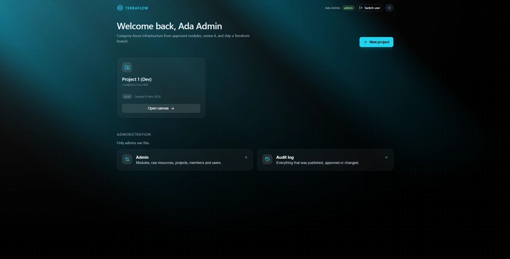<br><sub><b>Home.</b> Your projects, GitHub settings and, for admins, Administration.</sub></td>
<td width="33%">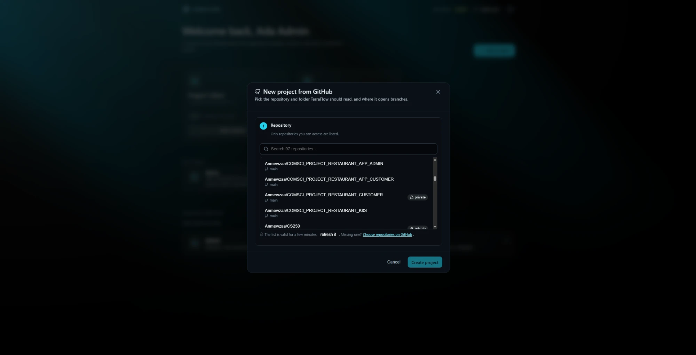<br><sub><b>New project.</b> Pick one of the repositories you can reach.</sub></td>
</tr>
</table>

### Build, preview, review

<table>
<tr>
<td width="50%">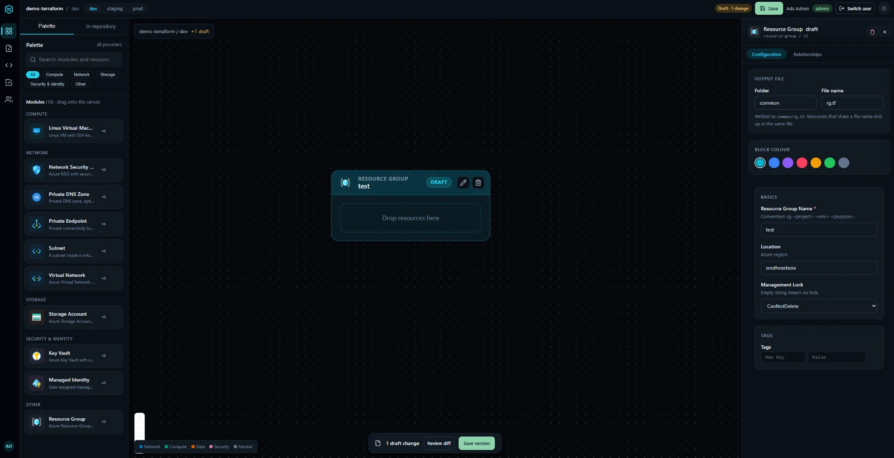<br><sub><b>Canvas.</b> A searchable palette with categories and a version for each module, nested boards, a form drawn from the schema, and the output file for each resource.</sub></td>
<td width="50%">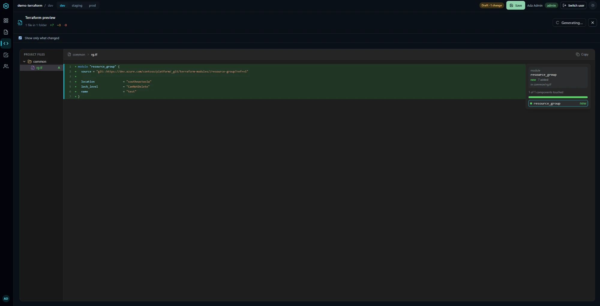<br><sub><b>HCL preview.</b> The files the change would add or edit, shown as a diff, with the touched resources on the right.</sub></td>
</tr>
<tr>
<td width="50%">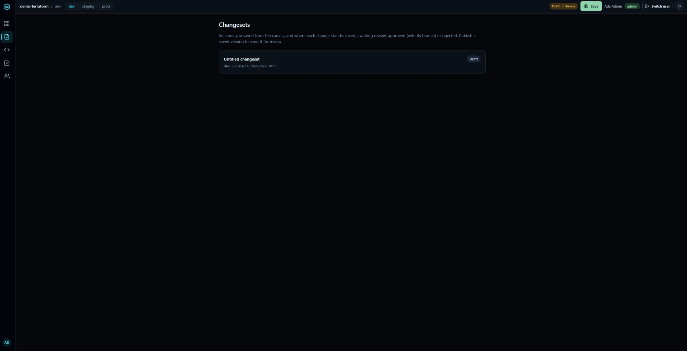<br><sub><b>Changesets.</b> Each saved version and where it stands: saved, awaiting review, approved or rejected.</sub></td>
<td width="50%">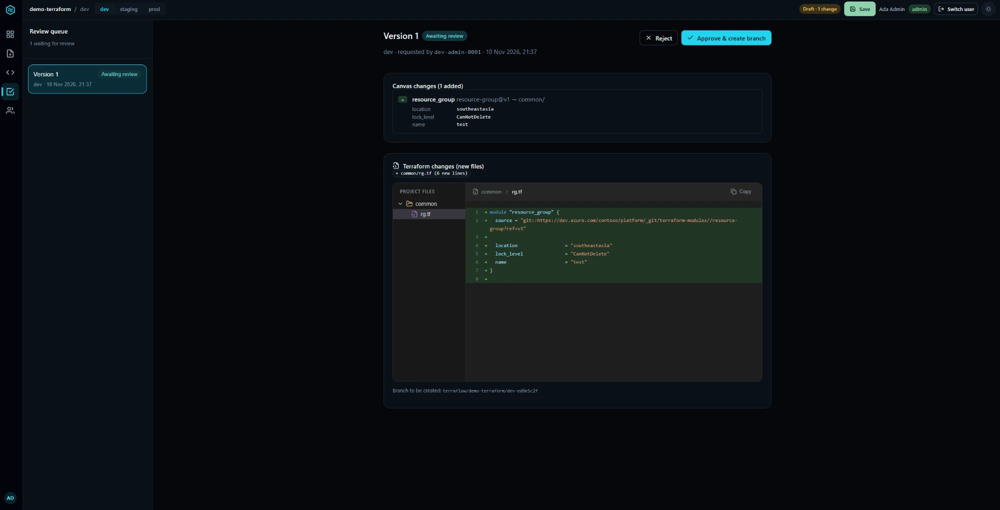<br><sub><b>Review.</b> Canvas changes beside the Terraform changes. Approve creates the branch.</sub></td>
</tr>
</table>

### Look after a project

Team and settings are one page. Owners and co-owners decide who builds and who approves, and how the Terraform is written: which providers, where new resources go, variables and starter files.

<table>
<tr>
<td width="50%">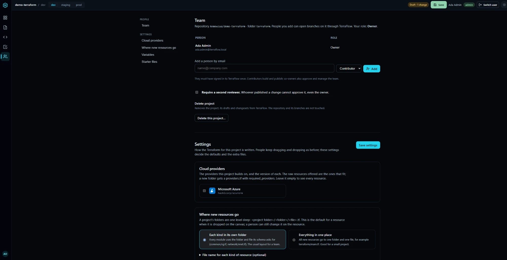<br><sub><b>Team.</b> Roles, an optional second reviewer, and the project's cloud providers.</sub></td>
<td width="50%">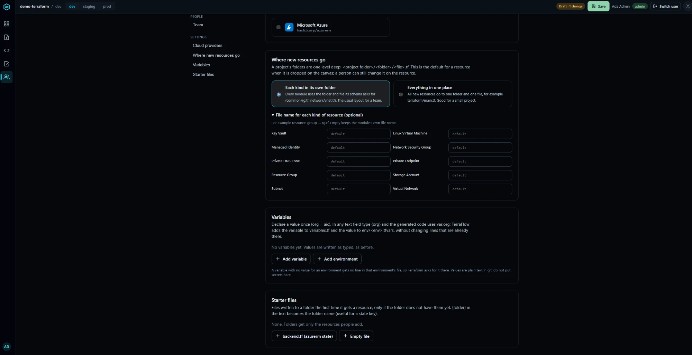<br><sub><b>Layout, variables, starter files.</b> Write <code>{org}</code> in a field and the code uses <code>var.org</code>; <code>variables.tf</code> and <code>env/&lt;env&gt;.tfvars</code> are added for you.</sub></td>
</tr>
<tr>
<td colspan="2" align="center">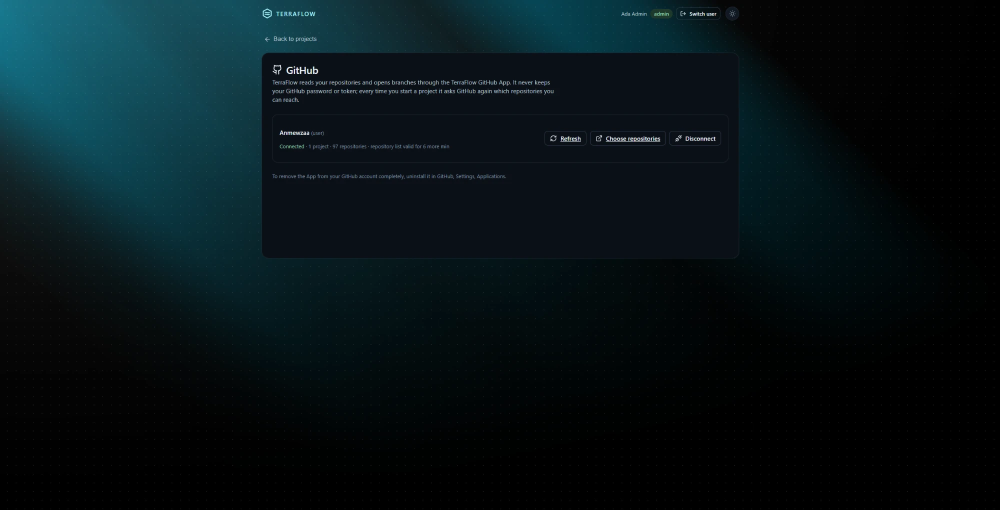<br><sub><b>GitHub.</b> Your connected accounts, refresh the repository list, choose which repositories the App may use. Nothing is kept: the list is read again each time.</sub></td>
</tr>
</table>

### Administration

For admins: the catalog, who may sign in, and every project at a glance. Each screen has a **Docs** button with a short walk-through for someone who has never used it.

<table>
<tr>
<td width="50%">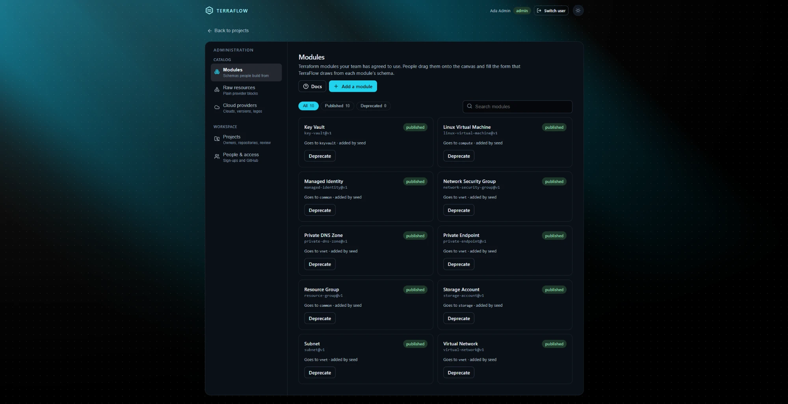<br><sub><b>Modules.</b> The schemas people build from; a published version never changes, publish v2 instead.</sub></td>
<td width="50%">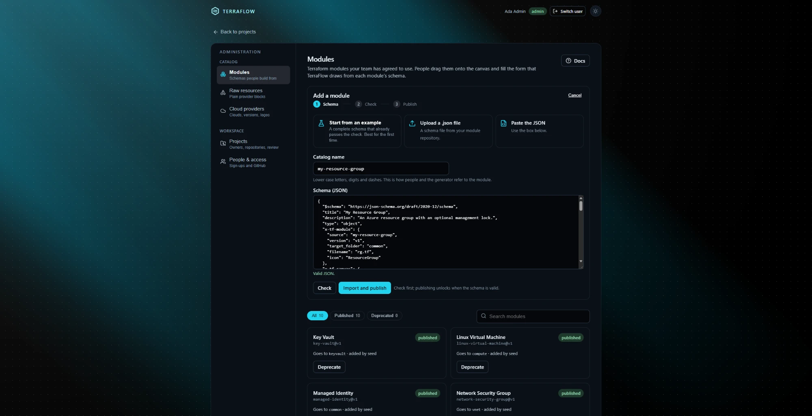<br><sub><b>Add a module.</b> Start from an example, upload or paste a schema, check it, publish.</sub></td>
</tr>
<tr>
<td width="50%">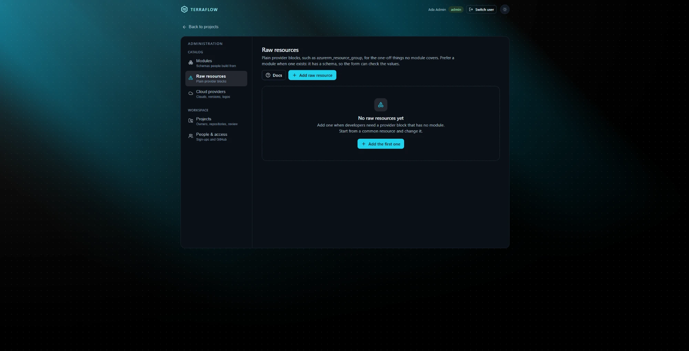<br><sub><b>Raw resources.</b> Plain provider blocks for the one-off things no module covers.</sub></td>
<td width="50%">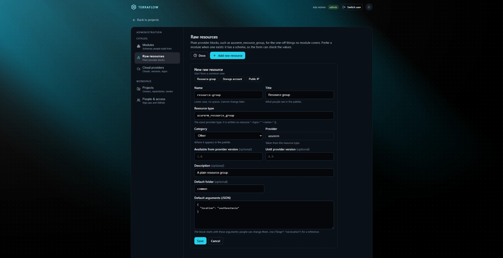<br><sub><b>New raw resource.</b> Category and the provider versions it exists in; the palette offers only what fits the project.</sub></td>
</tr>
<tr>
<td width="50%">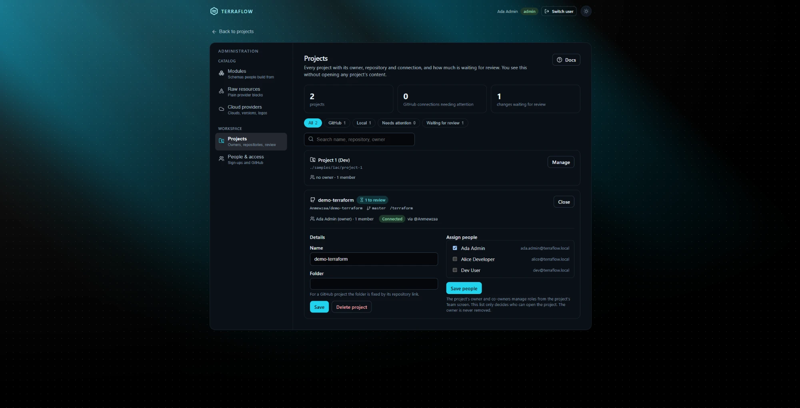<br><sub><b>Projects.</b> Owner, repository, connection health and what waits for review.</sub></td>
<td width="50%">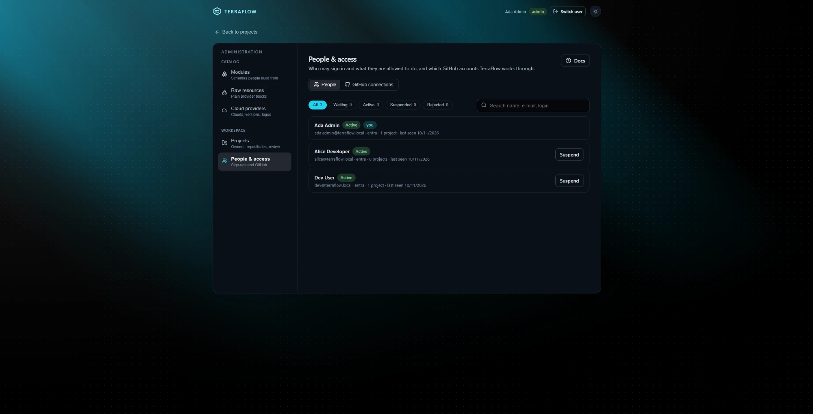<br><sub><b>People and access.</b> Approve or suspend sign-ups.</sub></td>
</tr>
<tr>
<td width="50%">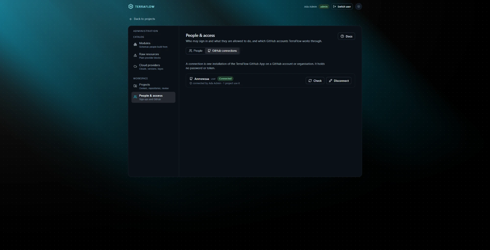<br><sub><b>GitHub connections.</b> Each installation of the App, who connected it, how many projects use it.</sub></td>
<td width="50%">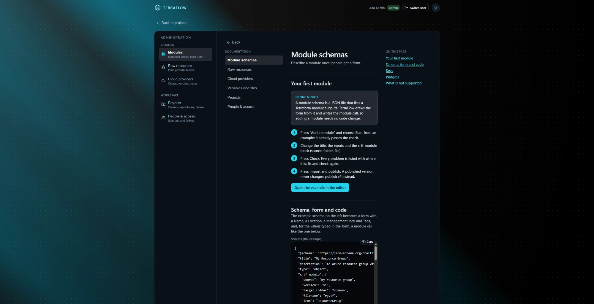<br><sub><b>Docs page.</b> "In one minute" first, the keys you always need before the full list, a Copy button on every sample.</sub></td>
</tr>
</table>

<details>
<summary>More: the raw resources documentation page</summary>
<br>
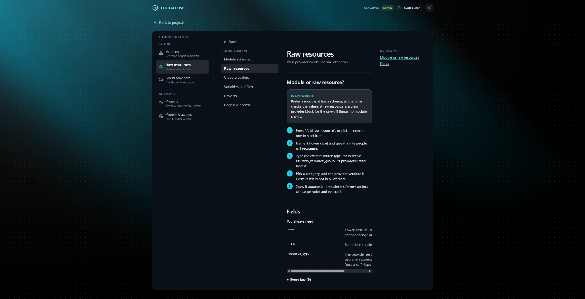
</details>

## Features

- **Canvas**: the resources of a project laid out by folder (React Flow and ELK), nested boards such as subnets inside a virtual network, and arrows between resources.
- **Palette**: search, category chips, the project's providers with logo and version, and a version choice for every module. Anything that does not fit the project's provider or version is hidden.
- **Edit what exists**: open a module call already in the repository; only the changed block is rewritten.
- **Variables and files**: declare `org = aic` once; generated code uses `var.org`, with `variables.tf`, `env/<env>.tfvars`, `providers.tf` and starter files such as `backend.tf`.
- **Save and publish**: *Save* keeps a named version of your draft while you keep working; *Publish* sends one for review.
- **Review**: approve (creates the branch) or reject (with a reason); a second reviewer can be required.
- **Roles**: owner, co-owner and contributor per project; a global admin for the catalog and people.
- **Audit log**: saves, publishes, approvals, project and module changes.
- **Light and dark** themes.

## Tech stack

| Layer | Choice |
|---|---|
| Backend | Go, chi + `net/http`, `hashicorp/hcl/v2` (parse + `hclwrite`), pgx, goose migrations |
| Frontend | React, TypeScript, Vite, React Flow, ELK, Tailwind |
| Database | PostgreSQL (Entra passwordless in production) |
| Auth | Entra ID (OIDC) and GitHub sign-in with a server-side session; a local sign-in for development |
| Deploy | Not decided yet. A Docker image and a Helm chart for a local cluster exist |

## Repository layout

| Path | Contents |
|---|---|
| `server/` | Go backend: HCL parser and generator (`internal/hcl`), catalog, API, auth, store |
| `web/` | React app and the design system (`src/design-system`) |
| `api/openapi.yaml` | The HTTP contract |
| `deploy/helm/terraflow/` | Helm chart ([how to use it](deploy/helm/terraflow/README.md)) |
| `docs/` | Scope, tech stack, phases, decisions, design system, conventions, glossary |
| `samples/` | Synthetic IaC fixtures: modules and a project tree |
| `catalog/` | Module catalog seed |

## Run it locally

```bash
make dev                      # Postgres in Docker + the Go server on :8080
npm --prefix web ci
npm --prefix web run dev      # the UI on :5173, proxying /api to :8080
```

Open <http://localhost:5173> and pick a user (an admin sees Administration and can
approve; a developer sees the projects an admin assigned to them).

On a local Kubernetes cluster, with its own Postgres:

```bash
docker build -t terraflow:local .
helm upgrade --install terraflow deploy/helm/terraflow -n terraflow --create-namespace \
  --set image.repository=terraflow --set image.tag=local
bash scripts/portforward.sh   # keeps `kubectl port-forward` alive
```

## Checks

```bash
gofmt -l . && go vet ./... && go test ./...
npm --prefix web run lint && npm --prefix web run build && npm --prefix web test
```

## Documentation

Start at [docs/README.md](docs/README.md). The ones to read first:
[scope](docs/01-scope.md), [tech stack](docs/02-tech-stack.md),
[phases](docs/03-phases.md), [decisions](docs/04-decisions.md),
[conventions](docs/06-conventions.md) and [glossary](docs/07-glossary.md).
Contributors and coding agents: see [CLAUDE.md](CLAUDE.md) (it is the contributing guide) and
[SECURITY.md](SECURITY.md). Synthetic IaC samples: [samples/](samples/README.md).

## Status

Phases 1-7 are done against `samples/` and a local repository. Phase 8 (GitHub, user-owned projects,
sign-in with GitHub and Entra, D-049 and D-050) is built through M2 and tested against a fake GitHub;
it has not yet run against real GitHub, and M3 (flexible catalog, schema editor) is next.
See [docs/03-phases.md](docs/03-phases.md). Hosting is not decided.
