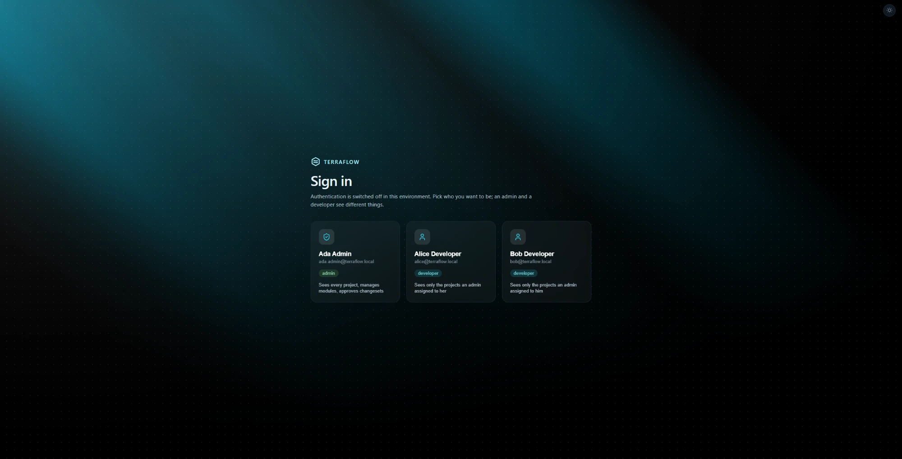
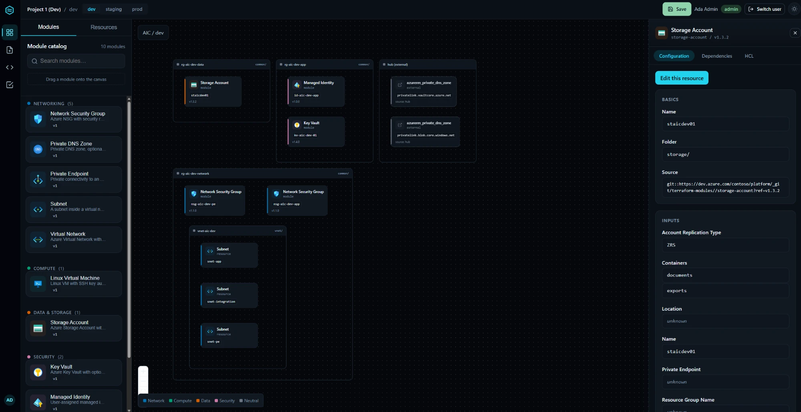
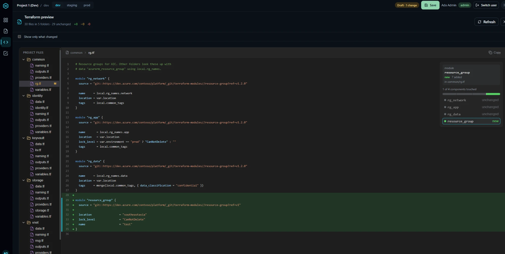
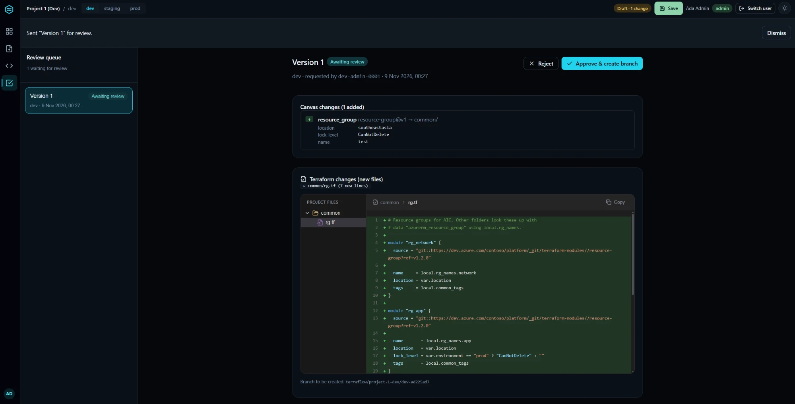
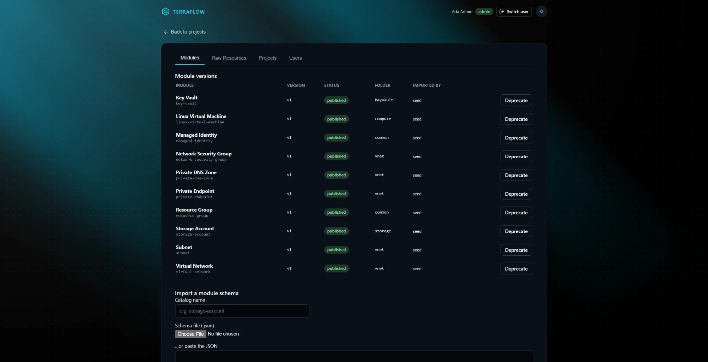
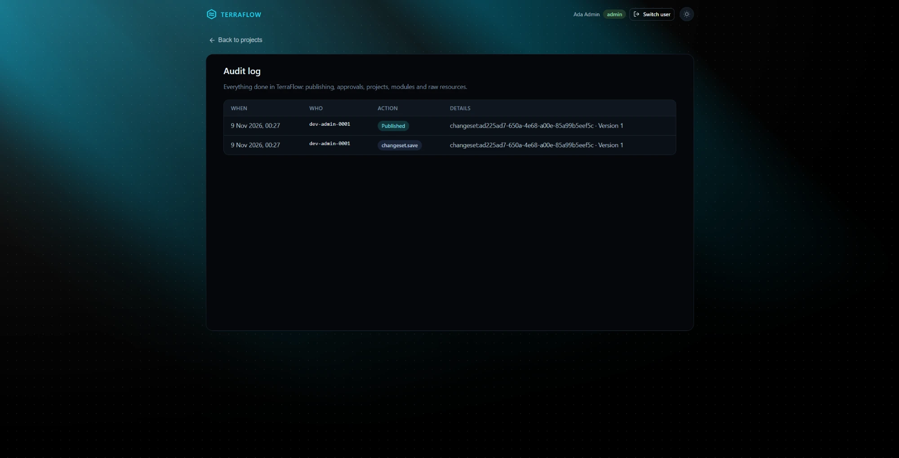

# TerraFlow

A visual, drag-and-drop portal for Azure infrastructure. Developers compose
resources from an **approved module catalog**, a DevOps reviewer approves, and
TerraFlow generates Terraform **module calls** in the team's own style and opens a
**branch** on the project's Azure DevOps repo.

**The app's job ends at the branch.** The pull request, pipeline, plan and apply
stay with DevOps in Azure DevOps. TerraFlow never calls Azure and holds no write
credentials.

## Project overview

```
 Developer                    Reviewer (DevOps)               Azure DevOps repo
 ─────────                    ─────────────────               ─────────────────
 drag modules onto            see canvas changes and          a branch with the
 the canvas, fill the   ──►   the exact .tf diff,       ──►   generated module calls;
 schema-driven forms          approve or reject               PR / pipeline are DevOps'
 Save a version, Publish      (with a reason)
```

| Idea | What it means |
|---|---|
| **Schema-driven** | Every form is rendered from a module's `variables.tf` (as JSON Schema). Adding a module needs no UI code. |
| **Module calls, not raw resources** | The generator writes `module "x" { source = … }` blocks, with a config-driven file layout. Raw provider resources exist only when a developer adds one explicitly. |
| **Reads the repo, not Azure** | The existing resource inventory is built by parsing the `.tf` files; values that cannot be evaluated are shown as `unknown`, never as `0` or healthy. |
| **Review before any branch** | One changeset waits for review per project; approving it creates the branch, rejecting it needs a reason. |
| **Safe round trips** | Golden-file and round-trip tests make sure untouched bytes, including comments, stay exactly as they were. |

### Features

- **Canvas** – existing resources of a project laid out by folder (React Flow + ELK), module catalog and raw resources in a side panel, nested boards (for example subnets inside a virtual network), and arrows between resources.
- **Edit what already exists** – open a module call that is already in the repository; only the changed block is rewritten.
- **Save and publish** – *Save* keeps a named version of your draft (Version 1, 2, …) while you keep working; *Publish* sends a saved version for review from the Changesets page.
- **HCL preview** – a full-page, diff-coloured view of the files the changeset would create or change.
- **Review** – approve (creates the branch) or reject (with a reason); separation of duties (a requester cannot approve their own changeset) is configurable.
- **Admin** – module versions and schema import, raw resources, projects, members and users.
- **Audit log** – saves, publishes, approvals, project and module changes.
- **Light and dark** themes.

### Screenshots

| Screenshot |
|:---:|
| <br>**Sign in** – local development login, pick a made-up user. |
| <br>**Home** – projects, plus Administration for admins. |
| <br>**Canvas** – module catalog, folders and nested boards, schema-driven form. |
| <br>**HCL preview** – generated module call shown as a diff. |
| <br>**Review** – canvas changes, Terraform changes, Approve or Reject. |
| <br>**Admin** – module versions and schema import. |
| <br>**Audit log** – everything done in TerraFlow. |

## Tech stack

| Layer | Choice |
|---|---|
| Backend | Go, chi + `net/http`, `hashicorp/hcl/v2` (parse + `hclwrite`), pgx, goose migrations |
| Frontend | React, TypeScript, Vite, React Flow, ELK, Tailwind |
| Database | PostgreSQL (Entra passwordless in production) |
| Auth | Entra ID (OIDC) with a server-side session; a local sign-in for development |
| Deploy | Docker image, Helm chart for AKS (with an optional bundled Postgres for local clusters) |

## Repository layout

| Path | Contents |
|---|---|
| `server/` | Go backend: HCL parser and generator (`internal/hcl`), catalog, API, auth, store |
| `web/` | React app and the design system (`src/design-system`) |
| `api/openapi.yaml` | The HTTP contract |
| `deploy/helm/terraflow/` | Helm chart ([how to use it](deploy/helm/terraflow/README.md)) |
| `docs/` | Scope, tech stack, phases, decisions, design system, conventions, glossary |
| `samples/` | Synthetic IaC fixtures: modules and a project tree |
| `catalog/` | Module catalog seed |

## Run it locally

```bash
make dev                      # Postgres in Docker + the Go server on :8080
npm --prefix web ci
npm --prefix web run dev      # the UI on :5173, proxying /api to :8080
```

Open <http://localhost:5173> and pick a user (an admin sees Administration and can
approve; a developer sees the projects an admin assigned to them).

On a local Kubernetes cluster, with its own Postgres:

```bash
docker build -t terraflow:local .
helm upgrade --install terraflow deploy/helm/terraflow -n terraflow --create-namespace \
  --set image.repository=terraflow --set image.tag=local
bash scripts/portforward.sh   # keeps `kubectl port-forward` alive
```

## Checks

```bash
gofmt -l . && go vet ./... && go test ./...
npm --prefix web run lint && npm --prefix web run build && npm --prefix web test
```

## Documentation

Start at [docs/README.md](docs/README.md). The ones to read first:
[scope](docs/01-scope.md), [tech stack](docs/02-tech-stack.md),
[phases](docs/03-phases.md), [decisions](docs/04-decisions.md),
[conventions](docs/06-conventions.md) and [glossary](docs/07-glossary.md).
Contributors and coding agents: see [CLAUDE.md](CLAUDE.md) and
[CONTRIBUTING.md](CONTRIBUTING.md). Synthetic IaC samples: [samples/](samples/README.md).

## Status

Working local build, Phases 1–6 done or in progress against `samples/` and a local
repository; see [docs/03-phases.md](docs/03-phases.md). Next: security hardening and
the Azure DevOps integration (phases 7 and 8). Until then nothing is pushed to a
real repository.
