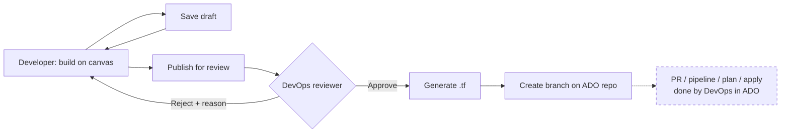

# 01 — Scope

Status: agreed (v0, 2026-11-07)

## In-app flow

The app's responsibility ends when the branch is created.

1. A developer opens a **Project** and builds on the canvas by dragging and dropping modules.
2. **Save** keeps the work as a draft in Postgres. **Publish** submits it for review.
3. A **DevOps reviewer** reviews it in the web UI with a canvas diff and an HCL diff.
   - There is **no `terraform plan` in the app**. The real plan is reviewed in the ADO PR pipeline.
4. **Approve:** Terraflow generates `.tf` (module calls and `data` blocks) and creates a new branch on the project's ADO repo.
5. **Reject:** the reviewer must give a reason. The request goes back to the developer, who can edit and publish again.

## Two-stage approval

| Stage | Where | Purpose |
|---|---|---|
| 1 | Terraflow | Approve before any branch exists, so unreviewed requests cannot create branches |
| 2 | ADO PR review | Normal DevOps process. Terraflow has no part in it |

## v1 boundaries

- **In:** create new resources (as module calls), and reference existing resources.
- **Not in v1:** modify resources that already exist or that were written by hand. This is planned for Phase 7.

## Out of scope

- PR creation, merge, pipelines, plan, apply
- Any call to Azure (read or write)
- Notifications (Teams, email)
- A CI pipeline for Terraflow itself

## Users and roles

- Roles come from **Entra ID group claims** at SSO login. There is no manual role screen.
  - Platform/DevOps group → **DevOps** (review, approve, manage modules and guardrails)
  - App-team group → **Developer** (build on canvas, request from approved modules, read-only on complex HCL)
- A **Project** maps to one ADO repo/project and one Entra group. Membership comes from
  existing Entra/ADO permissions. Developers see only the projects whose group they belong to.

## Data ownership

| Data | Stored in |
|---|---|
| Drafts, review status, reject reasons, audit trail (who approved what, and when) | PostgreSQL (Terraflow's own DB, which may also serve other uses later) |
| Infrastructure definition | ADO Git repo (single source of truth) |
| Terraform state | Not touched by Terraflow |

## Referencing existing resources (cross-folder)

The team's convention is that one folder refers to resources from another folder
with `data` sources (see `samples/README.md`).

- Terraflow builds an **inventory** of existing resources by parsing `.tf` on the
  repo's main branch. It uses the same engine as the read-only visualizer.
  Terraflow does **not** read from Azure.
- A developer can pick only resources from their own project's repo. Values that
  can be derived (for example, the resource group of a chosen VNet) are filled in
  and **locked**.
- Terraflow generates the required `data` blocks in the team's style, so DevOps
  does not hand-write them.
- **Known constraint:** resource names built from `var`, `locals` and `.tfvars`
  must be evaluated per environment.
- **Future option (not in scope):** check that a resource really exists, using
  Azure Resource Graph with the Reader role.
