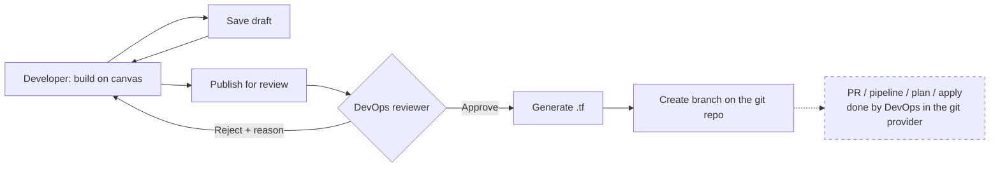

# 01 — Scope

Status: agreed (v0, 2026-11-07; updated 2026-11-09 for D-032, D-036, D-037, D-043, D-044, D-049, D-050)

## In-app flow

The app's responsibility ends when the branch is created.

1. A developer opens a **Project** and builds on the canvas by dragging and dropping modules.
2. The working copy is auto-saved as a draft in Postgres. **Save** snapshots it as a named version ("Version N"); **Publish**, from the Changesets page, sends a saved version for review (D-044). A project has at most one changeset waiting for review at a time (D-043).
3. A **reviewer** (the project owner or a co-owner, D-050) reviews it in the web UI with a canvas diff and an HCL diff.
   - There is **no `terraform plan` in the app**. The real plan is reviewed in the PR pipeline of the git provider.
4. **Approve:** Terraflow generates `.tf` (module calls and `data` blocks) and creates a new branch on the project's GitHub repository (Azure Repos later, D-049).
5. **Reject:** the reviewer must give a reason. The request goes back to the developer, who can edit and publish again.

## Two-stage approval

| Stage | Where | Purpose |
|---|---|---|
| 1 | Terraflow | Approve before any branch exists, so unreviewed requests cannot create branches |
| 2 | PR review in the git provider | The team's normal process. Terraflow has no part in it |

## v1 boundaries

- **In:** create new resources (as module calls, or as raw resources an admin prepared, D-040/D-041), edit module calls that already exist in the repo (D-036), and reference existing resources.
- **Editing existing resources:** module calls already in the repository can be edited from Phase 6 (D-036). **Not yet:** hand-written blocks that cannot be written back faithfully (`dynamic` or labelled nested blocks), and edits that keep comments inside the edited block (Phase 9).

## Out of scope

- PR creation, merge, pipelines, plan, apply
- Any call to Azure (read or write)
- Notifications (Teams, email)
- A CI pipeline for Terraflow itself

## Users and roles

Anyone can sign in (with GitHub or with Entra, D-050), but by default a new user is **pending**
until an admin approves them (`TF_SIGNUP_MODE=approval`). Once active, they use TerraFlow with
their own repositories. The admin approves people, not projects or changesets.

**Global role.** `admin` is the operator's role (`TF_ADMIN_USERS`, optionally an Entra group). An
admin sees every project's metadata (name, owner, repository, members, status, audit), manages
connections, schemas in the global catalog and users, and can disconnect or transfer a project.
Opening a project's canvas or diff needs "support access", which is audited each time. Everyone
else has no global role. A user is `pending`, `active`, `rejected` or `suspended`; a pending user
can only see a waiting page.

**Project roles.** The person who creates a project is its **owner**; the owner invites people who
have signed in and gives them a role.

| Role | Can |
|---|---|
| Owner | Everything: approve, invite, set roles, manage the project's schemas, disconnect the repository, delete or transfer the project |
| Co-owner | Approve, invite, set roles below owner, manage the project's schemas; cannot delete or transfer |
| Contributor | Build on the canvas, save versions, publish for review; cannot approve |

The owner may approve their own changes. A per-project setting can require a second reviewer.
Inviting someone lets them open branches on the project's repository through TerraFlow.

**Connecting a repository (two layers).** (1) The owner of a GitHub account or organisation
installs the TerraFlow GitHub App and chooses which repositories it may see. (2) A user connects a
repository to a project by authorizing with GitHub; the list contains only repositories that the
installation can see **and** that this user can access. A project is one repository and one folder in
it, picked from lists, never typed. In local development a folder of the local repo can be used.

With Entra and GitHub sign-in both off (local build only) a sign-in page lists made-up users so
the roles can be tried (D-043).

## Data ownership

| Data | Stored in |
|---|---|
| Projects, members, users, module catalog and raw resource templates, drafts, saved versions, review status, reject reasons, audit trail (who approved what, and when) | PostgreSQL (Terraflow's own DB, which may also serve other uses later) |
| Infrastructure definition | The project's git repository (single source of truth) |
| Terraform state | Not touched by Terraflow |

## Referencing existing resources (cross-folder)

The team's convention is that one folder refers to resources from another folder
with `data` sources (see `samples/README.md`).

- Terraflow builds an **inventory** of existing resources by parsing `.tf` on the
  repo's main branch. It uses the same engine as the read-only visualizer.
  Terraflow does **not** read from Azure.
- A developer can pick only resources from their own project's repo. Values that
  can be derived (for example, the resource group of a chosen VNet) are filled in
  and **locked**.
- Terraflow generates the required `data` blocks in the team's style, so DevOps
  does not hand-write them.
- **Known constraint:** resource names built from `var`, `locals` and `.tfvars`
  must be evaluated per environment.
- **Future option (not in scope):** check that a resource really exists, using
  Azure Resource Graph with the Reader role.
