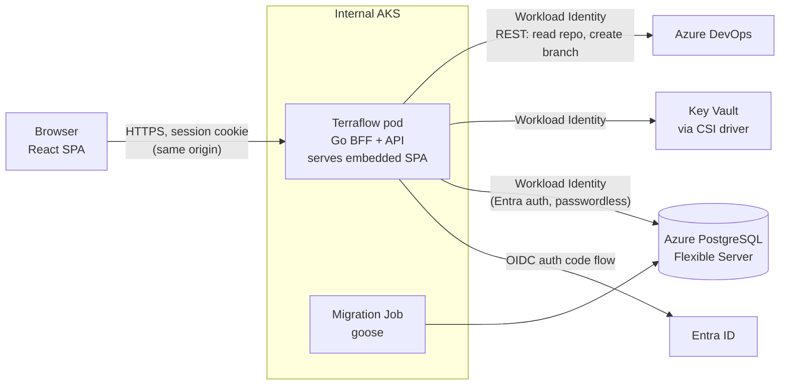

# 02 — Tech stack

Status: agreed (v1, updated 2026-11-09 to match the code as built). Items marked *planned* are not in the code yet.

## Architecture

There is no connection from Terraflow to Azure Resource Manager.

## Frontend

| Concern | Choice | Notes |
|---|---|---|
| Language / build | React + TypeScript + Vite | |
| Canvas | React Flow (xyflow) | |
| Auto-layout | ELK (`elkjs`) | Handles nested groups (RG ⊃ VNet ⊃ Subnet), which dagre does not handle well |
| Canvas state | Zustand | Also used internally by React Flow |
| Server state | TanStack Query | |
| Schema forms | Hand-written `SchemaForm` + custom widgets | Renders the admin-registered JSON Schema (D-015, D-019); widgets cover key/value, lists, locked fields and picking an existing resource. `react-jsonschema-form` is not used |
| Diff / code view | `react-syntax-highlighter` + a small line diff (`web/src/lib/diff.ts`) | HCL preview and the review screen. Monaco is not used |
| Styling / components | Tailwind CSS v4 (utilities only) + Harbor/Aurora design system | D-026, D-028. No Fluent UI or shadcn/ui; the question is closed |

## Backend

| Concern | Choice | Notes |
|---|---|---|
| Language | Go | |
| HTTP | `net/http` + `chi` | Compatible with the standard library |
| API contract | OpenAPI 3.1 (`api/openapi.yaml`) | Maintained by hand next to the handlers; the Go server and the TS types (`web/src/types/`) are **not** generated yet (*planned*: add generation and a drift check) |
| HCL | `hashicorp/hcl/v2` + `hclwrite` | Keeps comments, formatting and ordering, so PR diffs stay small |
| Expression evaluation | `go-cty` | Evaluates `var`, `locals` and `.tfvars` for the inventory |
| DB access | `pgx` with hand-written SQL in `server/internal/store/` | No ORM and no `sqlc` so far (*planned* if the query count grows) |
| Migrations | `goose` (001-012, additive, each with a working `Down`) | Embedded SQL; a pre-deploy Kubernetes Job is *planned* for Phase 8 |
| Canvas storage | JSONB | |
| Branch writer | `internal/localrepo` (local `git worktree`, D-027) today; `internal/ado` (hand-written REST client, Pushes API) in Phase 8 | `internal/ado` is an empty package until then. Same `BranchWriter` signature |
| Logging | `slog` (JSON) | |

## Security

| Concern | Choice |
|---|---|
| User auth | Entra ID with the **BFF pattern** (the local build can also sign in as a made-up user, `TF_AUTH_DISABLED` + `TF_DEV_LOGIN`, D-043; never active with auth on): the backend runs the OIDC flow and keeps the session in an httpOnly, Secure, SameSite cookie. Tokens never reach the browser |
| App credential | Target: a **federated credential** bound to Workload Identity, so there is no client secret (Phase 8). The local build still reads `TF_ENTRA_CLIENT_SECRET` from the environment |
| Service identity | **One** Azure Workload Identity for PostgreSQL, Key Vault and ADO |
| PostgreSQL auth | Entra auth (passwordless). Tokens are refreshed per connection through the `pgxpool` `BeforeConnect` hook |
| Secrets | Key Vault through the CSI driver. It holds only the session encryption key |
| ADO permissions | Contribute + Create branch, on the target repos only. Branch policies are never bypassed |
| Azure permissions | Access to Terraflow's own DB and Key Vault only. **No** access to ARM or subscriptions |
| Login hardening (D-047) | PKCE (S256) and a nonce check on every login; session ids are stored as SHA-256; CORS allows only `TF_ALLOWED_ORIGINS` (none by default); writes a browser marks cross-site are refused; security headers on every response; sign-in and callback are rate limited; the server will not start with `TF_AUTH_DISABLED=true` and Entra settings together |
| Group overage | The token should contain only groups assigned to the application. The backend detects the overage claim and fails with a clear error. It does not call Microsoft Graph |

**Why one identity:** a single pod would hold every identity anyway, so splitting
identities would not reduce the blast radius. Least privilege is applied on each
target instead. Real separation would need a separate branch-writer service, which
can be revisited if security review requires it.

## Deploy

| Concern | Choice |
|---|---|
| Packaging | **Single container image.** Go embeds the built React assets (`embed`) and serves them from the same origin as the API |
| Base image | `alpine:3.20` today, because approving a changeset runs the `git` CLI (`internal/localrepo`). Phase 8 uses the ADO REST API instead, so a distroless or bank-approved base image becomes possible then |
| Orchestration | Helm chart on the existing internal AKS |
| Build | Dependencies can be built and packaged outside the air-gapped network and brought in |
| CI pipeline | Out of scope |

## Testing

| Type | What it checks | When |
|---|---|---|
| Unit | Go (`testing`), frontend (Vitest) | From Phase 1 |
| Postgres | Store and API tests run against a throwaway database when `TF_TEST_PG_DSN` is set, and are **skipped** otherwise | Run them before every PR |
| **Golden file** | Canvas JSON → generated `.tf`, compared byte-for-byte with expected files | From Phase 4 (the most important test) |
| **Round-trip** | Parse → modify → write. Untouched parts, including comments, stay byte-identical | From Phase 1 |
| Integration | Real Postgres in a container. ADO mocked with `httptest` | From Phase 2 |
| `terraform validate` | Generated output is valid Terraform (needs a provider mirror) | Later |
| E2E | Full browser flow (Playwright) | Later |
