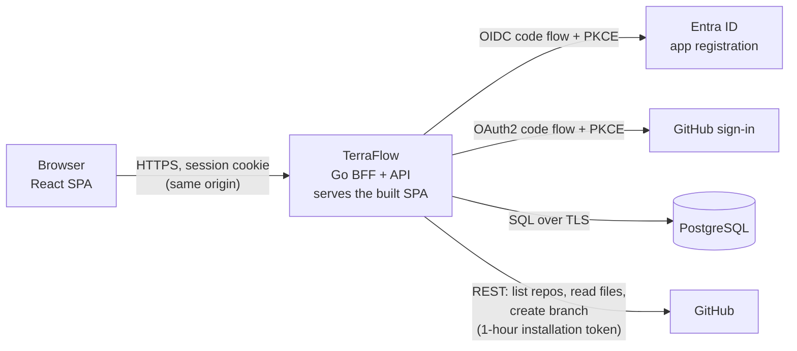

# 02 — Tech stack

Status: agreed (v3, updated 2026-11-09 for D-049 and D-050: GitHub, user-owned projects, host not decided). Items marked *planned* are not in the code yet.

## Architecture

Phase 8 (D-049, D-050) dropped the Azure service plan (AKS, Azure PostgreSQL with Entra, Key
Vault, Workload Identity). The host is not decided; the code keeps to three principles so
that any host works: no new disk writes, no `git` binary and no in-process state, one
database URL, and migrations as a separate command. Azure Repos can be added later behind the
same provider interface.

There is no connection from Terraflow to Azure Resource Manager.

## Frontend

| Concern | Choice | Notes |
|---|---|---|
| Language / build | React + TypeScript + Vite | |
| Canvas | React Flow (xyflow) | |
| Auto-layout | ELK (`elkjs`) | Handles nested groups (RG ⊃ VNet ⊃ Subnet), which dagre does not handle well |
| Canvas state | Zustand | Also used internally by React Flow |
| Server state | TanStack Query | |
| Schema forms | Hand-written `SchemaForm` + custom widgets | Renders the admin-registered JSON Schema (D-015, D-019); widgets cover key/value, lists, locked fields and picking an existing resource. `react-jsonschema-form` is not used |
| Diff / code view | `react-syntax-highlighter` + a small line diff (`web/src/lib/diff.ts`) | HCL preview and the review screen. Monaco is not used |
| Styling / components | Tailwind CSS v4 (utilities only) + Harbor/Aurora design system | D-026, D-028. No Fluent UI or shadcn/ui; the question is closed |

## Backend

| Concern | Choice | Notes |
|---|---|---|
| Language | Go | |
| HTTP | `net/http` + `chi` | Compatible with the standard library |
| API contract | OpenAPI 3.1 (`api/openapi.yaml`) | Maintained by hand next to the handlers; the Go server and the TS types (`web/src/types/`) are **not** generated yet (*planned*: add generation and a drift check) |
| HCL | `hashicorp/hcl/v2` + `hclwrite` | Keeps comments, formatting and ordering, so PR diffs stay small |
| Expression evaluation | `go-cty` | Evaluates `var`, `locals` and `.tfvars` for the inventory |
| DB access | `pgx` with hand-written SQL in `server/internal/store/` | No ORM and no `sqlc` so far (*planned* if the query count grows) |
| Migrations | `goose` (001-012, additive, each with a working `Down`) | Embedded SQL. In Phase 8 they run as a separate command (`terraflow migrate`) at deploy, not at every start (D-049) |
| Canvas storage | JSONB | |
| Git provider | `internal/gitprovider` (*planned*, Phase 8): a `github` implementation (GitHub App, Git Data API) and `local` (the current `localrepo` with `git worktree`, D-027) for development and tests; Azure Repos later. Hand-written REST clients | `internal/ado` stays empty until then. Same one-commit-on-a-new-branch contract as `BranchWriter` |
| Logging | `slog` (JSON) | |

## Security

| Concern | Choice |
|---|---|
| User auth | The **BFF pattern**: the backend runs the sign-in and keeps a server-side session in an httpOnly, Secure, SameSite cookie; tokens never reach the browser. Two providers (Phase 8): Entra OIDC (app registration, free) and GitHub OAuth2 (the same GitHub App). Users are `entra:<oid>` and `github:<id>`; no automatic linking. The local build can also sign in as a made-up user (`TF_AUTH_DISABLED` + `TF_DEV_LOGIN`, D-043); never active together with Entra settings |
| App credentials | The Entra client secret and the GitHub App client secret and private key are held in the environment of the host (`.env.local` in development) |
| Git credentials | GitHub App: only the installation id is stored; each call exchanges a signed JWT for a one-hour token limited to one repository (`contents: write`, `metadata: read`); tokens are never stored; the App private key lives only in the environment. A user's own GitHub token is used during one request and discarded (D-050) |
| PostgreSQL auth | A password in the environment, TLS required (one URL setting). Row level security on every table with no policy, in case the database also exposes a data API |
| Secrets | Only in the host's environment: database URL, Entra client secret, GitHub App private key and client secret, admin list. The session cookie is a random id and Postgres stores its SHA-256 (D-047) |
| Branch permissions | The credential can create a branch on the chosen repository only. Branch protection on the default branch is required in the target repository, because a GitHub App cannot be limited to branch names. Branch policy is never bypassed |
| Azure permissions | **None.** No ARM or subscription access, no Azure credential at all |
| Login hardening (D-047) | PKCE (S256) and a nonce check on every login; session ids are stored as SHA-256; CORS allows only `TF_ALLOWED_ORIGINS` (none by default); writes a browser marks cross-site are refused; security headers on every response; sign-in and callback are rate limited; the server will not start with `TF_AUTH_DISABLED=true` and Entra settings together |
| Group overage | The token should contain only groups assigned to the application. The backend detects the overage claim and fails with a clear error. It does not call Microsoft Graph |

**Why one identity:** a single pod would hold every identity anyway, so splitting
identities would not reduce the blast radius. Least privilege is applied on each
target instead. Real separation would need a separate branch-writer service, which
can be revisited if security review requires it.

## Deploy

| Concern | Choice |
|---|---|
| Packaging | The Go server serves the built SPA from the same origin as the API. A Docker image exists for local clusters |
| Runtime rules | No `git` binary, no persistent disk, no shared memory between instances: the provider API replaces `localrepo`, state lives in Postgres, migrations are a separate command (D-049). The host is not decided |
| Orchestration | Not decided. The Helm chart is kept for a local cluster |
| Build | Dependencies can be built and packaged outside the air-gapped network and brought in |
| CI pipeline | GitHub Actions: Go and web checks with a Postgres service (D-013 withdrawn, D-049) |

## Testing

| Type | What it checks | When |
|---|---|---|
| Unit | Go (`testing`), frontend (Vitest) | From Phase 1 |
| Postgres | Store and API tests run against a throwaway database when `TF_TEST_PG_DSN` is set, and are **skipped** otherwise | Run them before every PR |
| **Golden file** | Canvas JSON → generated `.tf`, compared byte-for-byte with expected files | From Phase 4 (the most important test) |
| **Round-trip** | Parse → modify → write. Untouched parts, including comments, stay byte-identical | From Phase 1 |
| Integration | Real Postgres in a container. the git provider mocked with `httptest` | From Phase 2 |
| `terraform validate` | Generated output is valid Terraform (needs a provider mirror) | Later |
| E2E | Full browser flow (Playwright) | Later |
