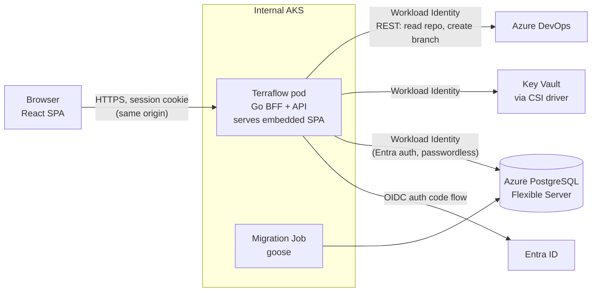

# 02 — Tech stack

Status: agreed (v0, 2026-11-07). The UI component library is still open.

## Architecture

There is no connection from Terraflow to Azure Resource Manager.

## Frontend

| Concern | Choice | Notes |
|---|---|---|
| Language / build | React + TypeScript + Vite | |
| Canvas | React Flow (xyflow) | |
| Auto-layout | ELK (`elkjs`) | Handles nested groups (RG ⊃ VNet ⊃ Subnet), which dagre does not handle well |
| Canvas state | Zustand | Also used internally by React Flow |
| Server state | TanStack Query | |
| Schema forms | react-jsonschema-form + custom widgets | The backend converts `variables.tf` to JSON Schema. Custom widgets cover cases such as choosing an existing VNet |
| Diff view | Monaco diff editor | HCL diff in the review screen |
| UI component library | **Open** | Fluent UI v9 vs shadcn/ui. To be decided with the UI design, before Phase 4 |

## Backend

| Concern | Choice | Notes |
|---|---|---|
| Language | Go | |
| HTTP | `net/http` + `chi` | Compatible with the standard library |
| API contract | OpenAPI | `oapi-codegen` (Go server), `openapi-typescript` (TS client) |
| HCL | `hashicorp/hcl/v2` + `hclwrite` | Keeps comments, formatting and ordering, so PR diffs stay small |
| Expression evaluation | `go-cty` | Evaluates `var`, `locals` and `.tfvars` for the inventory |
| DB access | `pgx` + `sqlc` | Type-safe SQL, no ORM |
| Migrations | `goose` | Runs as a Kubernetes Job before deploy |
| Canvas storage | JSONB | |
| ADO client | Small hand-written REST client | Only a few endpoints are needed. The Pushes API creates a branch and a commit in a single call |
| Logging | `slog` (JSON) | |

## Security

| Concern | Choice |
|---|---|
| User auth | Entra ID with the **BFF pattern**: the backend runs the OIDC flow and keeps the session in an httpOnly, Secure, SameSite cookie. Tokens never reach the browser |
| App credential | The app registration uses a **federated credential** bound to Workload Identity, so there is no client secret |
| Service identity | **One** Azure Workload Identity for PostgreSQL, Key Vault and ADO |
| PostgreSQL auth | Entra auth (passwordless). Tokens are refreshed per connection through the `pgxpool` `BeforeConnect` hook |
| Secrets | Key Vault through the CSI driver. It holds only the session encryption key |
| ADO permissions | Contribute + Create branch, on the target repos only. Branch policies are never bypassed |
| Azure permissions | Access to Terraflow's own DB and Key Vault only. **No** access to ARM or subscriptions |
| Group overage | The token should contain only groups assigned to the application. The backend detects the overage claim and fails with a clear error. It does not call Microsoft Graph |

**Why one identity:** a single pod would hold every identity anyway, so splitting
identities would not reduce the blast radius. Least privilege is applied on each
target instead. Real separation would need a separate branch-writer service, which
can be revisited if security review requires it.

## Deploy

| Concern | Choice |
|---|---|
| Packaging | **Single container image.** Go embeds the built React assets (`embed`) and serves them from the same origin as the API |
| Base image | distroless (replace with the bank-approved base image if one is mandated) |
| Orchestration | Helm chart on the existing internal AKS |
| Build | Dependencies can be built and packaged outside the air-gapped network and brought in |
| CI pipeline | Out of scope |

## Testing

| Type | What it checks | When |
|---|---|---|
| Unit | Go (`testing`), frontend (Vitest) | From Phase 1 |
| **Golden file** | Canvas JSON → generated `.tf`, compared byte-for-byte with expected files | From Phase 4 (the most important test) |
| **Round-trip** | Parse → modify → write. Untouched parts, including comments, stay byte-identical | From Phase 1 |
| Integration | Real Postgres in a container. ADO mocked with `httptest` | From Phase 2 |
| `terraform validate` | Generated output is valid Terraform (needs a provider mirror) | Later |
| E2E | Full browser flow (Playwright) | Later |
